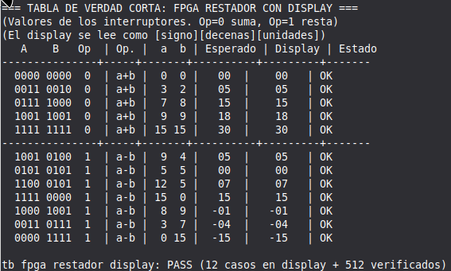
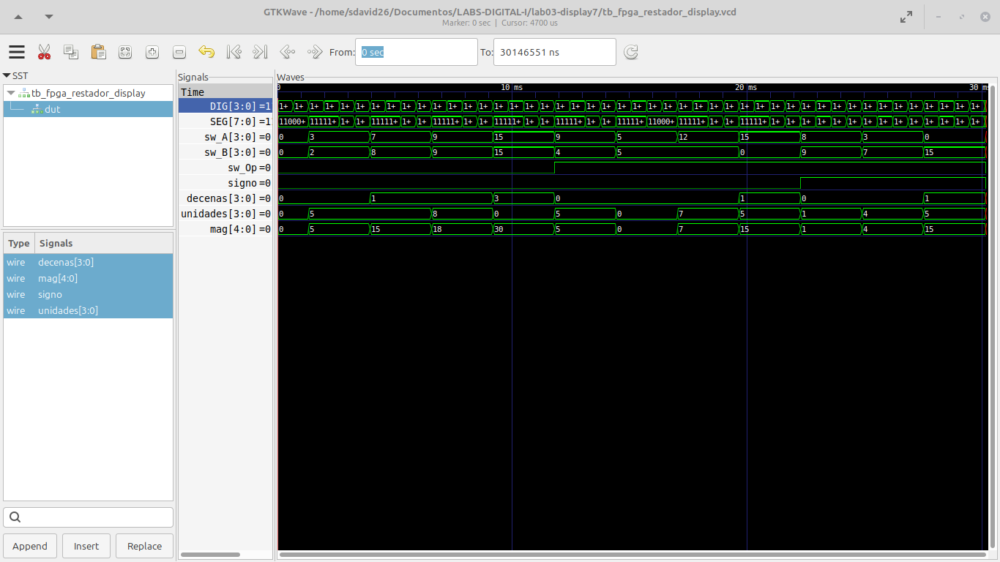

# Laboratorio 3: Sumador/restador con resultado en display de 7 segmentos

Diseño en Verilog para la FPGA Cyclone IV E (EP4CE6E22C8). Suma o resta dos
números de 4 bits y muestra el resultado final en el display de 7 segmentos:
unidades, decenas y signo negativo cuando corresponde. El resultado va de
0 a 30 en suma y de -15 a 15 en resta.

## Contenido

| Archivo | Descripción |
|---|---|
| [`s_1b.v`](s_1b.v) | Sumador completo de 1 bit |
| [`sumador.v`](sumador.v) | Sumador de 4 bits (ripple-carry) |
| [`sumador_restador.v`](sumador_restador.v) | Suma (Sel=0) o resta (Sel=1) de 4 bits |
| [`fpga_restador.v`](fpga_restador.v) | Top-level: detector de signo, magnitud, binario a BCD, decodificador de 7 segmentos y multiplexado |
| [`tb_fpga_restador_display.v`](tb_fpga_restador_display.v) | Testbench del resultado final en el display |

## Cómo funciona

El módulo `fpga_restador` encadena estos bloques:

| Módulo | Función |
|---|---|
| `sumador_restador` | Calcula A + B o A - B |
| `detector_signo` | Detecta resultado negativo (resta con acarreo 0, es decir A < B) |
| `calc_magnitud` | Obtiene el valor absoluto del resultado (0 a 30) |
| `bin_a_bcd` | Separa el valor en decenas y unidades |
| `bcd_7seg` | Convierte cada dígito BCD a segmentos (ánodo común) |
| `display_signo` | Dibuja el signo "-" (segmento g) |
| `mux_display` | Muestra un dígito a la vez: DIG1 unidades, DIG2 decenas, DIG3 signo |

Los interruptores A y B son de lógica negativa. El interruptor `Op` selecciona
la operación: `Op = 0` suma (A + B) y `Op = 1` resta (A - B).

### Asignación de pines

| Señal | Pines |
|---|---|
| `clk` | PIN_23 |
| `Op` | PIN_1 |
| `A[3:0]` | PIN_141, PIN_138, PIN_143, PIN_142 |
| `B[3:0]` | PIN_88, PIN_89, PIN_90, PIN_91 |
| `DIG[3:0]` | PIN_137, PIN_136, PIN_135, PIN_133 |
| `SEG[7:0]` | PIN_127, PIN_124, PIN_126, PIN_132, PIN_129, PIN_125, PIN_121, PIN_128 |

## Cómo simular

Requiere [Icarus Verilog](https://bleyer.org/icarus/) y GTKWave.

```bash
iverilog -s tb_fpga_restador_display -o sim_display s_1b.v sumador.v sumador_restador.v fpga_restador.v tb_fpga_restador_display.v
vvp sim_display
gtkwave tb_fpga_restador_display.vcd
```

El testbench imprime en la terminal una tabla con 12 casos (suma y resta) leídos
directamente del display, y verifica en silencio las 512 combinaciones posibles.
Al terminar muestra `PASS` o el número de errores.

### Cómo obtener las imágenes de GTKWave

1. Abre el archivo `.vcd` con `gtkwave tb_fpga_restador_display.vcd`.
2. En el panel izquierdo selecciona `tb_fpga_restador_display`, elige las señales
   `A`, `B`, `Op`, `SEG`, `DIG` y presiona **Append**. Expande `dut` y agrega
   `signo`, `mag`, `decenas` y `unidades`.
3. Usa **Time → Zoom → Zoom Full** para ver toda la simulación.
4. Clic derecho sobre una señal → **Data Format** para verla en binario o decimal.
5. Guarda la imagen con **File → Grab To File** o con una captura de pantalla.

## Resultados de simulación

### Tabla de verdad en la terminal

Casos de suma y resta leídos del display, con el resultado `PASS`.



### Formas de onda en GTKWave

Entradas A, B y Op, señales internas (signo, magnitud, decenas, unidades) y
salidas SEG y DIG.




## Resultados Practicos
[Reporte del Laboratorio 3 (PDF)](ANEXO_LABORATORIO_3.pdf)
