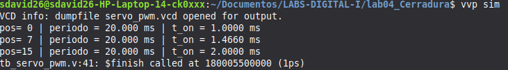
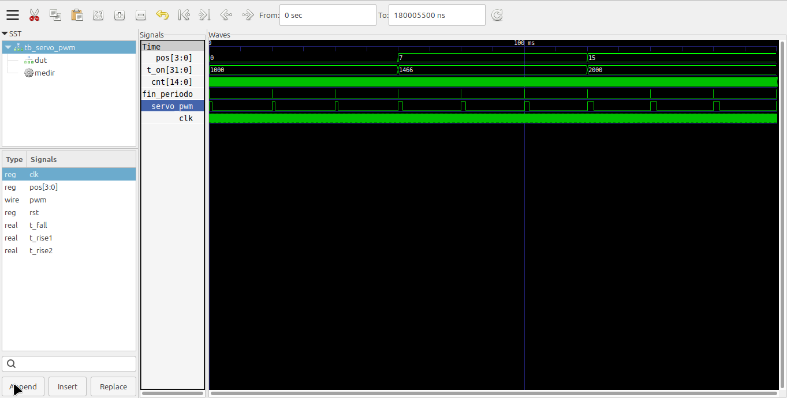

# Laboratorio 4: Servomotor PWM, teclado matricial y cerradura electrónica
 
Diseño en Verilog para la FPGA Cyclone IV E (EP4CE6E22C8). El laboratorio se
construye en tres partes que se integran en un único sistema: un generador PWM
para controlar un servomotor SG90, una interfaz para teclado matricial 4x4 con
sincronizador y antirrebote, y una cerradura electrónica con clave de 4 dígitos
controlada por una máquina de estados finitos (FSM).
 
## Contenido
 
| Archivo | Descripción |
|---|---|
| [`servo_pwm_gen.v`](servo_pwm_gen.v) | Generador PWM para servo (periodo 20 ms, pulso de 1 a 2 ms) |
| [`top_servo.v`](top_servo.v) | Top de la Parte 1: `sw[3:0]` controla la posición del servo |
| [`teclado_matricial.v`](PARTE%202/teclado_matricial.v) | Interfaz del teclado 4x4: sincronizador, escaneo, antirrebote y `key_valid` |
| [`top_teclado.v`](PARTE%202/top_teclado.v) | Top de la Parte 2: muestra `key_code` en los LEDs |
| [`registro_pass.v`](PARTE%203/registro_pass.v) | Registro de desplazamiento de 16 bits y contador de dígitos |
| [`fsm_cerradura.v`](PARTE%203/fsm_cerradura.v) | FSM de la cerradura, comparación de clave, temporizadores y buzzer |
| [`cerradura_top.v`](PARTE%203/cerradura_top.v) | Top de la Parte 3: integra todos los módulos y selecciona el modo |
| [`tb_servo_pwm.v`](tb_servo_pwm.v) | Testbench del generador PWM |
| [`tb_cerradura.v`](PARTE%203/tb_cerradura.v) | Testbench del sistema completo con modelo del teclado |
| [`cerradura.qpf`](PARTE%203/cerradura.qpf) / [`cerradura.qsf`](PARTE%203/cerradura.qsf) | Proyecto y asignación de pines de Quartus |
 
## Cómo funciona
 
El módulo `cerradura_top` encadena estos bloques:
 
| Módulo | Función |
|---|---|
| `teclado_matricial` | Lee el teclado y entrega `key_code[3:0]` y `key_valid` (pulso de 1 ciclo) |
| `registro_pass` | Almacena los 4 dígitos (0 a 9) con un registro de desplazamiento de 16 bits y cuenta cuántos se han ingresado |
| `fsm_cerradura` | Estados IDLE, INPUT, VERIFY, OPEN y ERROR; compara con `PASSWORD`, temporiza y genera `pos_servo` |
| `servo_pwm_gen` | Convierte `pos[3:0]` en una señal PWM de 20 ms con pulso entre 1 y 2 ms |
| `cerradura_top` | Instancia todo y elige la posición del servo según `modo` |
 
Todos los módulos usan un único reloj y el parámetro `CLK_FREQ`, de modo que el
testbench puede usar un valor reducido (1 MHz) para simular rápido.
 
### Parte 1: generador PWM (`servo_pwm_gen`)
 
Un contador de periodo se reinicia al llegar a `PERIOD - 1` (comparador de
reinicio) y un comparador mantiene la salida en alto mientras `cnt < t_on`.
 
| Parámetro | Tiempo | Cuentas (50 MHz) | Bits |
|---|---|---|---|
| Periodo del PWM | 20 ms | 1 000 000 | 20 |
| `T_ON` mínimo (`pos = 0`) | 1 ms | 50 000 | — |
| `T_ON` máximo (`pos = 15`) | 2 ms | 100 000 | — |
| Paso por unidad de `pos` | 66.67 µs | 3 333 | — |
 
El codificador es `t_on = T_MIN + pos * CLK_FREQ / 15000`, que reparte los
16 valores de `pos` de forma uniforme entre 1 ms y 2 ms.
 
### Parte 2: teclado matricial (`teclado_matricial`)
 
- Las columnas pasan por un **sincronizador de dos flip-flops**.
- El escaneo es activo en bajo: la fila activa vale 0 y las inactivas quedan en
  alta impedancia (`1'bz`) para evitar cortocircuitos.
- La fila cambia cada 1 ms. Al detectar una tecla se pausa el barrido.
- **Antirrebote de 10 ms** sobre la tecla detectada (la misma columna debe
  permanecer en 0).
- Si hay varias teclas en la misma fila, se ignoran.
- Una FSM interna (`S_SCAN`, `S_DEBOUNCE`, `S_ESPERA_SOLTAR`) espera 10 ms de
  tecla suelta antes de aceptar otra pulsación.
- `key_valid` se genera con un **detector de flanco** y dura un ciclo de reloj.
| Parámetro | Tiempo | Cuentas (50 MHz) | Bits |
|---|---|---|---|
| Escaneo (tiempo por fila) | 1 ms | 50 000 | 16 |
| Antirrebote | 10 ms | 500 000 | 19 |
 
Mapeo de teclas y códigos:
 
|        | Col 0 | Col 1 | Col 2 | Col 3 |
|--------|:-----:|:-----:|:-----:|:-----:|
| **Fila 0** | 1 | 2 | 3 | A |
| **Fila 1** | 4 | 5 | 6 | B |
| **Fila 2** | 7 | 8 | 9 | C |
| **Fila 3** | * | 0 | # | D |
 
`0` a `9` generan 0 a 9, `A` a `D` generan 10 a 13, `*` genera 14 y `#` genera 15.
 
### Parte 3: cerradura (`fsm_cerradura`)
 
| Estado | Servo (`pos`) | Descripción |
|---|---|---|
| IDLE | 0 (cerrado) | Espera el primer dígito (0 a 9) |
| INPUT | 0 (cerrado) | Almacena dígitos; con `*` borra y vuelve a IDLE; con 4 dígitos pasa a VERIFY |
| VERIFY | 0 (cerrado) | Compara `pass_in` con `PASSWORD` durante un ciclo |
| OPEN | 15 (abierto) | Abierta durante `T_ABIERTO` (5 s) o hasta presionar `*` |
| ERROR | 0 (cerrado) | Buzzer a 1 kHz durante `T_ERROR` (2 s) y vuelve a IDLE |
 
| Parámetro | Tiempo | Cuentas (50 MHz) | Bits |
|---|---|---|---|
| `T_ABIERTO` | 5 s | 250 000 000 | 28 |
| `T_ERROR` | 2 s | 100 000 000 | 27 |
 
La clave se define con el parámetro `PASSWORD` en BCD (por defecto `16'h1234`).
La comparación se hace con el operador de igualdad de Verilog (`==`), que la
herramienta sintetiza como XNOR por bit seguidas de una AND.
 
El interruptor `modo` selecciona el origen de la posición del servo: `modo = 0`
es manual (`sw[3:0]`, como en la Parte 1) y `modo = 1` es cerradura (la FSM).
 
### Asignación de pines
 
Definida en [`cerradura.qsf`](cerradura.qsf). Las columnas y filas del teclado
tienen `WEAK_PULL_UP_RESISTOR` activado.
 
| Señal | Pines |
|---|---|
| `clk` | PIN_23 |
| `rst` | PIN_25 |
| `sw[3:0]` | PIN_88, PIN_89, PIN_90, PIN_91 |
| `cols[3:0]` | PIN_10, PIN_3, PIN_1, PIN_143 |
| `rows[3:0]` | PIN_11, PIN_7, PIN_2, PIN_144 |
| `leds[3:0]` | PIN_84, PIN_85, PIN_86, PIN_87 |
| `key_valid` (Parte 2) | PIN_121 |
| `servo_pwm` | PIN_142 |
| `buzzer` | PIN_110 |
 
### Conexión del servo
 
```
FPGA servo_pwm (PIN_142) --> Señal del servo (amarillo / naranja)
GND FPGA ------------------> GND del servo y de la fuente (común)
Fuente externa 5 V --------> Vcc del servo (rojo)
```
 
El servo se alimenta con una fuente externa de 5 V. El GND de la fuente y el de
la FPGA deben ser comunes.
 
### Lógica de las entradas de la tarjeta
 
El botón `rst`, los switches y los LEDs de la tarjeta son activos en bajo. La
inversión se hace en los módulos top (`~rst`, `~sw`, `~key_code`), no dentro de
los módulos reutilizables.
 
## Cómo simular
 
Requiere [Icarus Verilog](https://bleyer.org/icarus/) y GTKWave.
 
### Generador PWM (Parte 1)
 
```bash
iverilog -s tb_servo_pwm -o sim_servo servo_pwm_gen.v tb_servo_pwm.v
vvp sim_servo
gtkwave servo_pwm.vcd
```
 
El testbench usa `CLK_FREQ = 1 MHz` e imprime periodo y ancho de pulso para
`pos = 0`, `pos = 7` y `pos = 15`. Los valores esperados son 20 ms de periodo y
1 ms, ≈1.47 ms y 2 ms de pulso.
 
### Sistema completo (Partes 2 y 3)
 
```bash
iverilog -s tb_cerradura -o sim_cerradura tb_cerradura.v cerradura_top.v teclado_matricial.v registro_pass.v fsm_cerradura.v servo_pwm_gen.v
vvp sim_cerradura
gtkwave cerradura.vcd
```
 
El testbench incluye un modelo del teclado (las columnas leen 0 cuando la fila
activa coincide con la tecla presionada) y ejecuta tres pruebas:
 
1. Clave correcta (1-2-3-4): la FSM ordena la apertura (`pos_fsm = 15`).
2. Cierre con `*` desde OPEN: `pos_fsm` vuelve a 0.
3. Clave incorrecta (5-6-7-8): el buzzer emite el tono de error.
### Cómo obtener las imágenes de GTKWave
 
1. Abre el archivo `.vcd` con `gtkwave cerradura.vcd`.
2. En el panel izquierdo selecciona `tb_cerradura`, elige `rst`, `modo`, `rows`,
   `cols`, `leds`, `buzzer` y `servo_pwm` y presiona **Append**. Expande `dut` y
   agrega `key_valid`, `key_code`, `pass_in`, `pos_fsm` y `inst_fsm.estado`.
3. Usa **Time → Zoom → Zoom Full** para ver toda la simulación.
4. Clic derecho sobre una señal → **Data Format** para verla en binario o decimal.
5. Guarda la imagen con **File → Grab To File** o con una captura de pantalla.
## Resultados de simulación
 
### Generador PWM
 
Salida de terminal con periodo y ancho de pulso para `pos = 0`, `7` y `15`.
 

 
Formas de onda de `servo_pwm` para tres posiciones.
 

 
### Teclado matricial
 
Escaneo de filas, columnas, `key_code` y pulso de `key_valid`.
 

 
### Sistema completo
 
Formas de onda del sistema: teclado, `pass_in`, estados de la FSM, `pos_fsm`,
`servo_pwm` y `buzzer`.
 

 
## Resultados Prácticos
 
[Reporte del Laboratorio 4 (PDF)](ANEXO_LABORATORIO_4.pdf)

